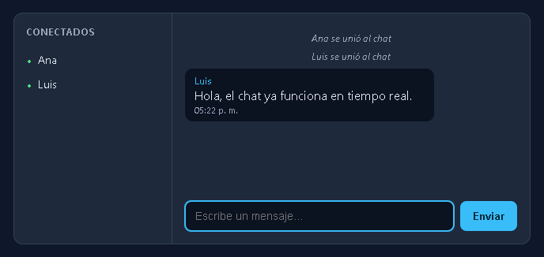

# Chat en tiempo real con Socket.IO

Aplicación web de chat multiusuario construida con Node.js, Express y Socket.IO.
Los mensajes se envían en tiempo real; el servidor asigna el autor y la hora,
mantiene la lista de personas conectadas y comparte los últimos 20 mensajes con
cada usuario que entra.

## Datos de entrega

<<<<<<< HEAD
- **Estudiante:** 06JuanV, Catalina Troncoso
- **Código:** pendiente de completar
- **Materia / grupo:** ing de sofware
=======
- **Estudiante:** Juan José Valencia, Catalina Troncoso, Jhon Alexander Misas, David Mahecha, Juan Camilo Lopez
- **Código:** 2220242041, 2220242001, 2220242047, 2220242008, 2220242033
- **Materia / grupo:** Ingeniería de Software
>>>>>>> bb1c0d8005e9bbfa4954e881d842d13f9257e1c5
- **Fecha:** 29/10/2026
- **Repositorio propio de entrega:** <https://github.com/06JuanV/web-socked-taller>
- **Versión de Node usada para validar:** v26.10.0<\´axx–>

> Completa tu nombre, código y materia antes de entregar. La URL indicada es el
> repositorio público que compartiste.

## Requisitos

- Usar Node.js 18 o superior
- npm

## Instalación y ejecución

```bash
git clone https://github.com/06JuanV/web-socked-taller.git
cd web-socked-taller
npm install
npm start
```

Abre <http://localhost:3000> en dos ventanas o navegadores distintos. Escribe un
nombre diferente en cada uno para probar el chat entre varias personas.

En desarrollo también puedes usar `npm run dev`, que reinicia el servidor cuando
detecta cambios en el código.

## Eventos implementados

| Evento | Lo emite | Lo escucha | Datos | Destinatario |
|---|---|---|---|---|
| `entrar` | Cliente | Servidor | Nombre; recibe confirmación `{ ok, error? }` | Servidor |
| `historial` | Servidor | Cliente | Arreglo con hasta 20 mensajes recientes | Solo el cliente que acaba de entrar |
| `sistema` | Servidor | Cliente | Texto de ingreso o salida | Todos los conectados |
| `mensaje` | Cliente y servidor | Servidor y clientes | El cliente envía solo el texto; el servidor publica `{ autor, texto, hora }` | Todos los conectados |
| `usuarios` | Servidor | Cliente | Arreglo de nombres conectados | Todos los conectados |
| `escribiendo` | Cliente y servidor | Servidor y clientes | El servidor determina el nombre | Todos menos quien está escribiendo |

El servidor valida y normaliza los nombres, evita nombres duplicados, limita la
longitud de nombres y mensajes, y obtiene el autor del `socket.id` asociado.
El historial y la lista de usuarios viven en memoria: se reinician cuando se
detiene el servidor.

## Retos del taller

- [x] **Reto 1:** entrar con nombre y avisar al chat.
- [x] **Reto 2:** enviar y recibir mensajes en tiempo real.
- [x] **Reto 3:** actualizar la lista de conectados.
- [x] **Reto 4:** mostrar el indicador de escritura únicamente a los demás.
- [x] **Reto 5:** retirar al usuario y avisar cuando se desconecta.
- [x] **Autor definido por el servidor:** el cliente transmite el texto, no el autor.

### Retos extra

- **Historial de 20 mensajes:** se conserva en memoria y se envía únicamente a
  quien acaba de entrar.
- **Nombres únicos:** no se permite el ingreso mientras otro usuario conectado
  tenga el mismo nombre (sin distinguir mayúsculas y minúsculas).

## Pruebas

```bash
npm test
```

La prueba de integración cubre el ingreso, nombres repetidos, lista de usuarios,
mensajes con autor asignado por el servidor, escritura visible solo para otros,
historial limitado a 20 mensajes y salida limpia.

## Capturas para la entrega



## Preguntas de sustentación

**1. ¿En qué se diferencian `socket.emit`, `socket.broadcast.emit` e `io.emit`?**

`socket.emit` envía un evento únicamente al cliente asociado a ese socket.
`socket.broadcast.emit` lo envía a todos los clientes conectados excepto al
socket que lo originó. `io.emit` lo envía a todos los clientes conectados.

**2. ¿Por qué el servidor no puede confiar en el nombre que manda el cliente?**

El navegador está bajo el control de quien lo usa y puede modificarse o enviar
eventos manualmente. Por eso el cliente solo manda el texto y el servidor usa el
nombre previamente asociado al `socket.id`.

**3. ¿Qué pasa con el `Map` de usuarios si el servidor se reinicia? ¿Cómo lo
arreglarías?**

El `Map` se pierde porque solo está en memoria. Para conservar usuarios y
mensajes entre reinicios se necesitaría almacenamiento externo, por ejemplo una
base de datos; en una aplicación con varias instancias también se puede usar un
adaptador compartido de Socket.IO, como el de Redis.

**4. ¿Qué es el fallback a long-polling y cuándo entra en acción?**

Socket.IO puede transportar eventos mediante HTTP long-polling cuando no logra
establecer o mantener WebSocket, por ejemplo si un proxy o una red bloquea la
conexión. La librería administra el transporte y la reconexión.

**5. Si hubiera 10.000 usuarios, ¿por qué `io.emit` en cada tecla presionada
sería un problema?**

Cada tecla multiplicaría los eventos enviados a los clientes conectados,
consumiendo ancho de banda y capacidad de procesamiento. Conviene limitar la
frecuencia de los avisos, agruparlos o usar salas para reducir destinatarios.

## Estado antes de publicar

- [x] `node_modules/` está excluido mediante `.gitignore`.
- [x] La aplicación y las pruebas funcionan localmente.
- [x] Repositorio público: <https://github.com/06JuanV/web-socked-taller>
- [x] Captura auténtica con dos usuarios: [capturas/chat.png](capturas/chat.png).
- [ ] Completar los datos del estudiante y la materia.
- [x] Historial con más de seis commits descriptivos.


.

## Fuentes

- [Documentación de Socket.IO](https://socket.io/docs/v4/)
- Guía del taller: <https://juanbonilla1305.github.io/taller-chat-socketio/>
